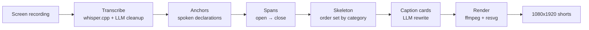

# AI Shorts

[繁體中文](README.zh-TW.md)

Turn one long, unedited trading-analysis screen recording into several ready-to-post 9:16 vertical shorts — one per trade — without opening a video editor.


Full reel with music: [docs/media/reel.mp4](docs/media/reel.mp4) (1920x1080, 40 s).

## Why

Existing auto-clippers (Opus Clip and friends) assume a talking head and pick "quotable sentences". A faceless TradingView recording breaks both assumptions: there is no face to track, and the value is the chart the speaker is pointing at, not the sentence. Their auto-crop also mangles candles and the price axis.

AI Shorts does not guess where the highlights are. While recording, the speaker simply says what is happening ("entering here", "that's a stop-loss"). Those spoken declarations become anchors, each anchor pair becomes one short, and the narrative is carried by on-screen caption cards rather than the speaker's voice.

## How it works



| Stage | Command | Output |
|---|---|---|
| Transcribe | `npm run transcribe -- <video>` | `transcript.json` — local whisper.cpp, then an LLM pass that fixes recognition errors and tags events by meaning |
| Anchors | `npm run anchors -- <transcript.json>` | `anchors.json` — pairs open/close anchors into spans; overlapping spans are an error, not a guess |
| Plan | `npm run plan -- <anchors.json>` | `plan-NN.json` — picks footage inside each span, fills the skeleton, writes caption cards |
| Render | `npm run render -- <plan.json>` | `NN-mmss-outcome.mp4` + `.md` with title/description |

Every stage writes plain JSON you can hand-edit and re-run from. LLM responses are cached on disk keyed by input hash, so re-running the same recording gives the same result and costs nothing.

Rendering details: the crop is measured, not configured — a pixel-level pass finds the chart band and drops the TradingView toolbars (ADR-0003). Caption cards are rendered as PNG layers with resvg instead of ffmpeg `drawtext`, so CJK line-breaking and emphasis colouring are under our control (ADR-0002). The speaker's voice is removed; the audio track is background music.

## Category-driven design

The engine knows no topic. It only manipulates abstract concepts — anchors, spans, skeleton positions, cards. Everything domain-specific lives in a **category** (`src/categories/trading.ts`):

- **Event vocabulary** — natural-language descriptions of what an "entry", "take-profit", "stop-loss" sounds like, read by the LLM, not matched as strings
- **Skeleton** — the narrative order (outcome hook first, then context → setup → entry → hold → reveal); positions reference anchor-relative windows and collapse when footage is missing
- **Glossary** — domain terms (FVG, Fibo, RR) the caption writer must spell correctly
- **Duration targets** and **background music**

Swap the category and the engine code stays untouched. v1 ships exactly one category: trading. See `CONTEXT.md` for the ubiquitous language and `docs/adr/` for the design decisions.

## Running it

Requirements: Node 20+, `ffmpeg`, `whisper-cli` (whisper.cpp) with `ggml-large-v3-turbo.bin` and `ggml-silero-v5.1.2.bin` in `~/.cache/whisper.cpp/models/`, and either `ANTHROPIC_API_KEY` (Console key) or a logged-in `claude` CLI as fallback.

```sh
npm install
npm run transcribe -- ~/Desktop/recording.mov      # -> out/recording/transcript.json
npm run anchors -- out/recording/transcript.json   # -> out/recording/anchors.json
npm run plan -- out/recording/anchors.json         # -> out/recording/plan-01.json ...
npm run render -- out/recording/plan-01.json --out out/recording [--music track.m4a]
```

Development:

```sh
npm test           # vitest, 169 tests, no network or ffmpeg needed
npm run typecheck  # tsc --noEmit
```

## Limitations

- **Personal tool.** Built for one person's recording workflow on macOS; no packaging, no GUI.
- **One category so far.** The category abstraction has a single implementation; it will probably need to change when a second one is added (ADR-0004 says so explicitly).
- **The recording must contain spoken declarations.** If the speaker never says "entry" / "stop-loss" (in any wording), there is nothing to anchor on, and the recording is rejected rather than guessed at.
- **Landscape chart in a portrait frame.** The 16:9 chart is fitted into a horizontal band of the 9:16 frame, so candles and price-axis labels end up small and much of the frame is empty. Smarter reframing (zooming into the active price region per segment) is the next step.
- **Background music is not included.** `assets/music/` is git-ignored; without a track, the renderer generates an ambient bed.
