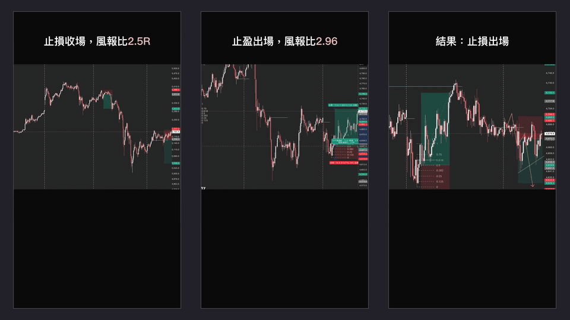
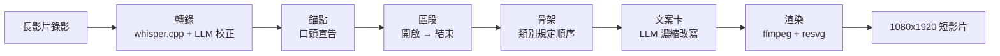

# AI Shorts

[English](README.md)

把一支未經剪輯的交易分析長螢幕錄影，自動剪成數支可直接發布的 9:16 直式短影片——每筆交易一支，不用開剪輯軟體。



含背景音樂的完整展示片：[docs/media/reel.mp4](docs/media/reel.mp4)（1920x1080，40 秒）。

## 為什麼

現成的自動剪輯工具（Opus Clip 之類）都假設畫面裡有人臉、價值在「講得好的話」。無人臉的 TradingView 錄影讓這兩個假設同時失效：沒有臉可以追，真正的價值是講者正對著的那張圖，而不是那句話。它們的自動裁切還會把 K 線和價格軸切爛。

AI Shorts 不猜哪裡是重點。錄影時講者只要把正在發生的事說出來（「這筆進場」「這筆止損」，措辭不拘），這些**宣告**就成為錨點，每組錨點產出一支短影片；敘事由畫面上的文案卡承載，不用講者原聲。

## 運作方式



| 階段 | 指令 | 產物 |
|---|---|---|
| 轉錄 | `npm run transcribe -- <影片>` | `transcript.json`——本機 whisper.cpp 辨識，再由 LLM 校正錯字並依語意標記事件 |
| 定位 | `npm run anchors -- <transcript.json>` | `anchors.json`——把開啟／結束錨點配成區段；區段重疊直接報錯，不猜 |
| 規劃 | `npm run plan -- <anchors.json>` | `plan-NN.json`——在區段內依內容選材、填入骨架、寫文案卡 |
| 渲染 | `npm run render -- <plan.json>` | `NN-分秒-結果.mp4` 與附標題／描述的 `.md` |

每個階段都產出可手改、可單獨重跑的 JSON。LLM 回應以輸入雜湊快取在磁碟上，同一支長影片重跑得到相同結果，也不再計費。

渲染細節：裁切框是量出來的而不是設定的——像素分析找出圖表帶並去掉 TradingView 工具列（ADR-0003）。文案卡以 resvg 渲染成 PNG 圖層，而不用 ffmpeg `drawtext`，中文斷行與重點上色才能自己掌控（ADR-0002）。講者原聲移除，音軌是背景音樂。

## 類別驅動的設計

引擎不認得任何題材，只操作抽象概念：錨點、區段、骨架位置、文案卡。所有題材知識都放在**類別**裡（`src/categories/trading.ts`）：

- **事件詞彙表**——以自然語言描述「進場」「止盈」「止損」聽起來像什麼，給 LLM 讀，不是給程式比對的字串
- **骨架**——敘事順序（結果先破梗當鉤子，再依序盤面 → 關鍵 K → 進場 → 持倉 → 揭曉）；位置引用錨點的相對窗口，素材不足時塌縮
- **術語表**——文案必須寫對的專有名詞（FVG、Fibo、RR）
- **長度目標**與**背景音樂**

換一個類別，引擎程式碼不動。v1 只實作交易分析一個類別。詞彙定義見 `CONTEXT.md`，設計決策見 `docs/adr/`。

## 執行

需求：Node 20+、`ffmpeg`、`whisper-cli`（whisper.cpp），並把 `ggml-large-v3-turbo.bin` 與 `ggml-silero-v5.1.2.bin` 放在 `~/.cache/whisper.cpp/models/`；LLM 使用 `ANTHROPIC_API_KEY`（Console 金鑰），沒有時退回本機已登入的 `claude` CLI。

```sh
npm install
npm run transcribe -- ~/Desktop/recording.mov      # -> out/recording/transcript.json
npm run anchors -- out/recording/transcript.json   # -> out/recording/anchors.json
npm run plan -- out/recording/anchors.json         # -> out/recording/plan-01.json ...
npm run render -- out/recording/plan-01.json --out out/recording [--music track.m4a]
```

開發：

```sh
npm test           # vitest，169 個測試，不需網路也不需 ffmpeg
npm run typecheck  # tsc --noEmit
```

## 限制

- **個人工具。**為一個人在 macOS 上的錄影流程而做；沒有打包，沒有 GUI。
- **目前只有一個類別。**類別抽象只有一個實作；加入第二個類別時介面大概需要修改（ADR-0004 明確記錄了這點）。
- **錄影裡必須有口頭宣告。**講者從沒說過「進場」「止損」（措辭不拘）的話就沒有錨點可用，這種長影片直接不受理，而不是硬猜。
- **橫式圖表塞進直式畫面。**16:9 的圖表被放進 9:16 畫面中的一條橫帶，K 線和價格軸文字偏小、畫面留白多。下一步是更聰明的重構圖（依片段放大當下活躍的價格區域）。
- **不含背景音樂檔。**`assets/music/` 不進版控；沒有音樂檔時渲染器會生成環境底樂。
